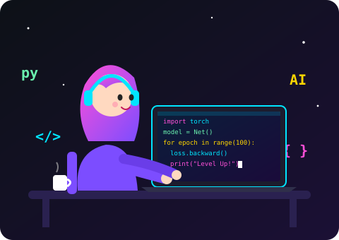

<!-- ============ HEADER ============ -->
<div align="center">

<!-- GAMING STYLE HEADER -->


<br/>

<!-- ANIMATED INTRODUCTION -->


<br/><br/>

<!-- SOCIAL LINKS -->
<a href="https://github.com/anshika870">

</a>

<a href="https://linkedin.com/in/anshika-bajpai/">

</a>

<a href="https://durga-jewellers-one.vercel.app">

</a>

<br/><br/>


</div>


<br/>

<table>
  <tr>
    <td align="center"><br/><b>👑 Anshika Bajpai</b></td>
    <td align="center"></td>
  </tr>
</table>

<br/>


</div>

---

## 🎮 `PLAYER_PROFILE.exe`

```yaml
name:       Anshika Bajpai
role:       Software Engineer 💻
achievement: "🏆 Built & launched a LIVE business website (Durga Jewellers)"
current_quest: "Java Backend (Spring Boot) ☕ + AI / ML 🤖"
power_ups:  [Problem Solving, Clean Code, Curiosity, Consistency]
motto:      "Code. Break. Fix. Level Up. Repeat."
```


- 👩‍💻 Software Engineer building real-world products
- 🌐 Created & deployed a **live business website** — [https://durga-jewellers-one.vercel.app/]
- ☕ Learning **Java Backend** — Spring Boot, REST APIs, DSA
- 🧠 Also diving into **Artificial Intelligence & Machine Learning**
- 🏢 IT Analyst at **NTT DATA** (Noida) · ex Full Stack Intern at Innovaneers
- 🔭 Exploring: NumPy, Pandas, Scikit-learn, TensorFlow, PyTorch, Generative AI
- 🌱 Goal: build AI-powered products that solve real problems
- ⚡ Fun fact: I debug with coffee ☕ and music 🎧

<br clear="right"/>

---

## 🕹️ `SKILL_TREE` — Tech Stack

<div align="center">

### ☕ Languages


### 🎨 Frontend


### ⚙️ Backend & Databases


### 🤖 AI / ML  *(Currently Learning)*


### 🛠️ Tools & Cloud


**Core CS:** `DSA` · `OOP` · `Operating Systems` · `DBMS` · `Computer Networks` · `REST API Design`

</div>


---

## 📊 `STATS_SCREEN`

<div align="center">


<br/>


<br/>


</div>

---

## 🏆 `ACHIEVEMENTS_UNLOCKED`

| 🎖️ Badge | Quest |
|---|---|
| 🥇 | Launched a **live business website** |
| 🥈 | Working as a **Software Engineer** at NTT DATA |
| 🥉 | Started the **AI/ML** journey |
| 🎓 | B.Tech CSE (CGPA 8.1), KIT Kanpur |
| 🔒 | Next: ship a Spring Boot + AI project |

---

## 🏅 `TROPHY_ROOM`

<div align="center">
  
</div>

---

## 🤝 `CONNECT_PLAYER_2`

<div align="center">

<a href="https://www.linkedin.com/in/anshika-bajpai/"></a>
<a href="mailto:officialanshika.bajpai@gmail.com"></a>
<a href="https://your-website.com"></a>


<br/><br/>


</div>
